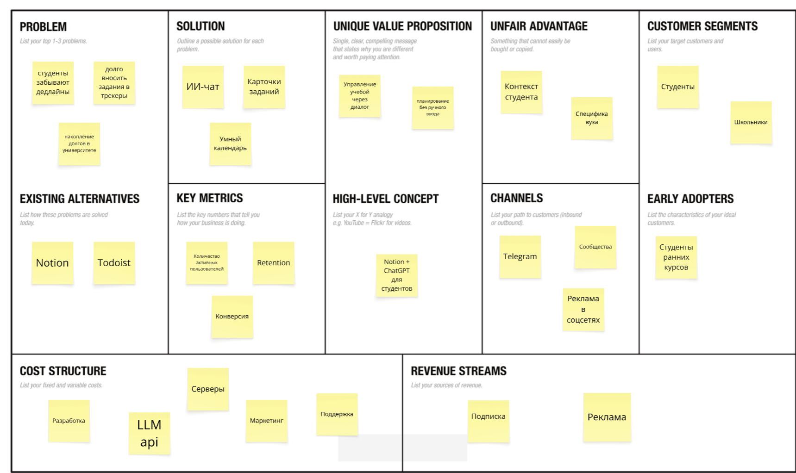
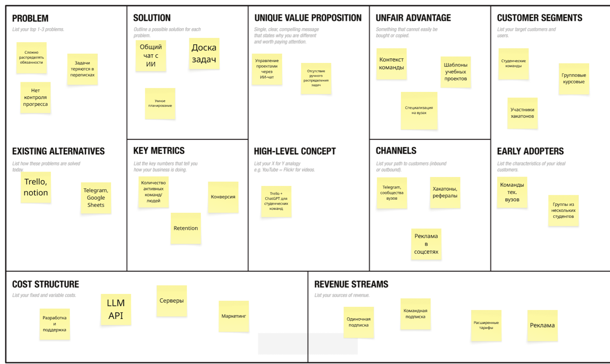

# Проект UniFlow

Курс: **Методы управления разработкой ПО**

# Задание №1. UniFlow

Бизнес-модель: B2C (Business-to-Consumer).

## Elevator Pitch

У студентов постоянно накапливаются разные задания: лабораторные, домашки, контрольные, курсовые и подготовка к экзаменам. Обычно приходится держать все это в голове или самому записывать в заметки и календарь. В итоге какие-то дедлайны забываются, а несколько больших работ остаются на последний день.

Идея UniFlow — сделать планировщик, которым можно управлять через обычный чат с ИИ. Например, студент пишет: «К пятнице сдать лабу по физике, во вторник контрольная по матану, а курсовую надо закончить до конца месяца». Приложение предложит карточки с названиями заданий, предметами и сроками. Если дата непонятна, ассистент уточнит ее. Потом задачи появятся в общем списке и календаре, а перед дедлайном придет напоминание.

Главное отличие от обычного таск-менеджера — не нужно каждый раз вручную заполнять поля. Через чат можно не только добавлять задания, но и переносить сроки, отмечать выполненные работы и просить составить план на неделю. Сервис будет в первую очередь рассчитан на студентов российских вузов. Основные функции останутся бесплатными, расширенные возможности ИИ будут по подписке.

## Lean Canvas №1 (UniFlow, B2C)

### 1. Сегменты потребителей (Customer Segments)

- Студенты вузов и колледжей.
- Студенты, у которых много лабораторных, контрольных и курсовых.
- Студенты, совмещающие учебу с работой.
- Школьники, которым тоже нужно отслеживать домашние задания и даты контрольных.

**Ранние последователи (Early Adopters):** студенты 1–3 курсов, которым приходится следить за дедлайнами по нескольким предметам одновременно.

### 2. Проблема (Problem)

1. Студенты забывают о дедлайнах или вспоминают о них слишком поздно.
2. На ручное заполнение календаря и списка заданий уходит время.
3. Из-за отсутствия нормального плана несколько работ накапливаются к одной дате.

**Существующие альтернативы (Existing Alternatives):** Notion, Todoist, Google Calendar, MyStudyLife, обычные заметки.

### 3. Уникальная ценность (Unique Value Proposition)

Все учебные задачи можно вести через один ИИ-чат. Студент пишет, что ему нужно сделать, а приложение само подготавливает карточки, дедлайны и план работы.

**High Level Concept:** Notion + ChatGPT для учебных задач и дедлайнов.

### 4. Решение (Solution)

- ИИ-чат для создания и изменения карточек заданий.
- Календарь с дедлайнами и напоминаниями.
- Планирование нагрузки и разбивка больших работ на этапы.

### 5. Каналы (Channels)

- Студенческие Telegram-каналы и сообщества вузов.
- Реклама в соцсетях, ориентированная на студентов.
- Рекомендации друзей и реферальная программа.
- Студенческие чаты и сообщества факультетов.

### 6. Потоки доходов (Revenue Streams)

- Подписка **UniFlow Pro — 149 руб./мес.**
- Годовая подписка со скидкой.
- Бесплатный тариф: ручное добавление заданий, календарь, напоминания и ограниченное число запросов к ИИ.
- Реклама в бесплатной версии приложения.

### 7. Структура издержек (Cost Structure)

- Разработка и поддержка приложения.
- Оплата запросов к языковой модели (LLM API).
- Сервер, база данных, хранение задач.
- Реклама и привлечение пользователей.
- Комиссии при оплате подписок.

### 8. Ключевые метрики (Key Metrics)

- MAU — активные пользователи за месяц.
- Retention — сколько пользователей возвращается в приложение.
- Conversion Rate — доля пользователей, купивших Pro.
- Количество созданных и выполненных задач.
- LTV/CAC — соотношение дохода от клиента и стоимости привлечения.

### 9. Скрытое преимущество (Unfair Advantage)

Упор на учебные задачи именно в вузах: лабораторные, РК, курсовые, зачеты и экзамены. Со временем у ассистента будет накапливаться контекст по предметам, срокам и привычкам студента, поэтому ему не придется каждый раз объяснять все заново. Пока это планируемое преимущество, а не то, что уже есть у готового продукта.

---

# Задание №2

## 1. HADI-гипотезы

### Гипотеза №1 — удобство ИИ-чата

Самый важный риск на старте: студентам может быть проще добавить задачу вручную, чем писать сообщение ассистенту.

- **H (Hypothesis):** предполагаем, что студентам удобнее создавать задания через ИИ-чат, чем вручную заполнять карточки.
- **A (Action):** дадим прототип 30 студентам на неделю. Каждый попробует оба способа добавления заданий. Для сравнения времени дадим одинаковый набор задач.
- **D (Data):** время создания одной карточки, количество ошибок в датах и предметах, доля участников, выбравших чат.
- **I (Insights):** будем считать гипотезу предварительно подтвержденной, если минимум 70% участников выберут ИИ-чат, а медианное время добавления задания уменьшится хотя бы на 30%.

### Гипотеза №2 — платная подписка

Второй риск: бесплатным приложением могут пользоваться, но покупать Pro не захотят.

- **H (Hypothesis):** предполагаем, что хотя бы 8% зарегистрированных пользователей оформят UniFlow Pro за 149 руб. в месяц ради расширенных функций ИИ.
- **A (Action):** после запуска работающей бесплатной версии предложим Pro группе из 200 зарегистрированных студентов. Возможности тарифа и его цена будут показаны заранее.
- **D (Data):** количество реальных оплат, конверсия регистраций в подписку, стоимость привлечения платящего пользователя.
- **I (Insights):** если оплатят не менее 8% пользователей, гипотезу готовности платить можно предварительно принять. Дальше нужно смотреть удержание и повторные оплаты.

## 2. Расчет юнит-экономики

Ниже предварительный расчет для UniFlow Pro. Цифры взяты как плановые показатели, их еще нужно будет проверить на реальных пользователях.

**Воронка привлечения и CAC (Customer Acquisition Cost):**

- Стоимость клика по рекламе (CPC) — **10 руб.**
- Конверсия клика в регистрацию — **40%**.
- Стоимость одной регистрации: `10 / 0,40 = 25 руб.`
- Конверсия регистрации в платную подписку — **10%**.
- **CAC = 25 / 0,10 = 250 руб.**

То есть на привлечение одного платящего пользователя планируем потратить около 250 рублей.

**Расчет LTV (Lifetime Value):**

- Подписка UniFlow Pro — **149 руб./мес.**
- Переменные расходы на обслуживание платящего пользователя (LLM, сервер, комиссия) — **39 руб./мес.**
- Маржинальный доход: `149 - 39 = 110 руб./мес.`
- Предполагаемый средний срок подписки — **7 месяцев**.
- **LTV = 110 × 7 = 770 руб.**

**Соотношение LTV/CAC:**

`770 / 250 = 3,08`

При таких показателях доход с одного клиента за время подписки больше стоимости его привлечения примерно в 3 раза. Значит, у этой модели есть запас для развития. Постоянные расходы на разработку сюда не включены, поэтому это расчет юнит-экономики, а не всей прибыли проекта.

## 3. Pivot

Один из вариантов дальнейшего развития — **UniFlow Teams**. Это переход от личного планировщика к инструменту для студенческих команд (Customer Segment Pivot). Модель B2C при этом не обязательно закрывать: командный формат можно сначала проверить отдельно.

Причина такого Pivot в том, что при выполнении курсовых и групповых проектов есть еще одна проблема: мало помнить свои задачи, нужно понимать, кто за что отвечает и как продвигается общая работа. В обычных чатах это быстро превращается в беспорядок.

### Elevator Pitch — UniFlow Teams

При совместной работе над курсовыми, лабораторными и учебными проектами студенты обычно обсуждают все в мессенджерах. Там же распределяют задачи, договариваются о сроках и отправляют результаты. Когда проект становится больше, сложно найти нужное сообщение, проверить, кто уже закончил свою часть, и что еще осталось сделать.

UniFlow Teams — общее рабочее пространство с ИИ-чатом для студенческой команды. Можно написать: «Сделай задачи по проекту, интерфейс назначь Диме, базу данных — Маше, срок две недели». Ассистент подготовит карточки с исполнителями и дедлайнами, после подтверждения они появятся на общей доске. Участники смогут менять статусы, смотреть общий календарь и получать напоминания.

В отличие от универсальных таск-менеджеров, здесь основной способ управления задачами — обычный диалог, а сами сценарии рассчитаны на учебные проекты. Оплачивается одна подписка на всю команду, а не отдельная для каждого участника.

## Lean Canvas №2 (UniFlow Teams)

### 1. Сегменты потребителей (Customer Segments)

- Студенческие команды, выполняющие групповые курсовые и лабораторные.
- Команды университетских проектов.
- Участники хакатонов и студенческих конкурсов.

**Ранние последователи (Early Adopters):** команды из 3–6 студентов технических вузов, работающие над проектом в течение нескольких недель или месяцев.

### 2. Проблема (Problem)

1. Сложно распределить обязанности между участниками.
2. Задачи и сроки теряются в переписках.
3. Не всегда понятно, на каком этапе находится общий проект.

**Существующие альтернативы (Existing Alternatives):** Trello, Notion, Telegram, Google Sheets.

### 3. Уникальная ценность (Unique Value Proposition)

Команда может вести учебный проект через общий ИИ-чат: создавать задачи, назначать ответственных и следить за дедлайнами без постоянного ручного заполнения доски.

**High Level Concept:** Trello + ChatGPT для студенческих команд.

### 4. Решение (Solution)

- Общий ИИ-чат для создания задач и назначения исполнителей.
- Совместная доска задач со статусами и сроками.
- Общий календарь, напоминания и отслеживание прогресса.

### 5. Каналы (Channels)

- Студенческие Telegram-сообщества.
- Реклама в социальных сетях.
- Хакатоны и университетские проектные мероприятия.
- Реферальная программа: приглашение другой команды.
- Сообщества факультетов и студенческих клубов.

### 6. Потоки доходов (Revenue Streams)

- Подписка для команды до 6 человек — **599 руб./мес.**
- Пробный период — 14 дней.
- Более дорогой тариф для крупных команд.
- Индивидуальная подписка для пользователей, которым не нужны командные функции.
- Реклама в бесплатном тарифе.

### 7. Структура издержек (Cost Structure)

- Разработка совместных досок и чата.
- Расходы на LLM API.
- Сервер и хранение данных команд.
- Реклама и привлечение команд.
- Техподдержка, комиссия за оплату.

### 8. Ключевые метрики (Key Metrics)

- Active Teams — количество активных команд.
- Конверсия пробного периода в оплату.
- Retention — сколько команд продлевают подписку.
- Количество выполненных задач в проектах.
- LTV/CAC по одной платящей команде.

### 9. Скрытое преимущество (Unfair Advantage)

Специализация на учебных проектах, готовые шаблоны для курсовых и групповых работ, а также история задач внутри команды. Со временем ИИ сможет учитывать участников и предыдущие этапы проекта. Это предполагаемое преимущество, которое нужно будет развивать.

### Предварительная экономика UniFlow Teams

Для сравнения посчитаем те же показатели, но уже для одной команды:

- Подписка — **599 руб./мес.**
- Переменные расходы — **129 руб./мес.**
- Маржинальный доход: `599 - 129 = 470 руб./мес.`
- Средняя продолжительность подписки — **5 месяцев**.
- Планируемый CAC одной команды — **600 руб.**
- **LTV = 470 × 5 = 2 350 руб.**
- **LTV/CAC = 2 350 / 600 = 3,92.**

По предварительной оценке командная подписка тоже может окупаться и при этом приносить больше маржинального дохода с одной оплаты. Но пока это расчетные значения, а не результаты продаж.

---

# Задание №3

Далее требования рассматриваются для первой версии **UniFlow (личный планировщик)**. Общие доски и назначение исполнителей относятся к UniFlow Teams и в первый MVP не входят.

## 1. Роли и User Stories

**Роли:**

1. **Первокурсник** — еще не привык к количеству самостоятельных заданий и сроков.
2. **Студент с большим количеством лабораторных** — ведет несколько работ одновременно и часто переносит их сдачу.
3. **Студент перед сессией** — должен распределить подготовку к зачетам и экзаменам.
4. **Студент, который делает курсовую** — работает над одной большой задачей в несколько этапов.
5. **Работающий студент** — хочет планировать учебу с учетом ограниченного свободного времени.

**User Stories:**

1. Как студент, я хочу написать ассистенту о новой домашке обычным сообщением, чтобы не заполнять карточку вручную.
2. Как студент, я хочу добавить сразу несколько заданий одним сообщением, чтобы не вводить их по одному.
3. Как студент, я хочу видеть, какие данные ИИ извлек из сообщения, чтобы проверить предмет и дедлайн перед сохранением.
4. Как студент, я хочу, чтобы ассистент уточнял непонятную дату, чтобы не создать задачу с неправильным сроком.
5. Как студент с лабораторными, я хочу менять дедлайн через чат, чтобы быстро учитывать переносы сдачи.
6. Как студент, я хочу вручную исправить карточку, если ИИ неверно понял мое сообщение.
7. Как студент, я хочу отмечать выполненные задания, чтобы они не мешали в списке текущих дел.
8. Как студент, я хочу видеть все ближайшие дедлайны, чтобы понимать нагрузку на неделю.
9. Как студент с лабораторными, я хочу фильтровать задания по предмету, чтобы не путаться между разными дисциплинами.
10. Как студент перед сессией, я хочу отдельно видеть зачеты и экзамены, чтобы заранее начать подготовку.
11. Как студент, я хочу получать напоминание перед дедлайном, чтобы не пропустить сдачу работы.
12. Как студент, я хочу самому выбрать, за сколько времени меня предупреждать о задаче, чтобы напоминания были полезными.
13. Как студент с курсовой, я хочу попросить ИИ разбить большую работу на этапы, чтобы делать ее постепенно.
14. Как работающий студент, я хочу указать свободные дни, чтобы ассистент не планировал учебу на рабочие смены.
15. Как студент, я хочу спросить «что у меня на этой неделе?», чтобы получить короткую сводку по задачам.
16. Как студент, я хочу задавать приоритеты работам, чтобы сначала заниматься наиболее срочными.
17. Как студент, я хочу добавлять задачу вручную, если не хочу тратить запросы к ИИ.
18. Как студент, я хочу видеть выполненные задания за месяц, чтобы понимать, сколько уже сделал.
19. Как студент, я хочу прикреплять к карточке ссылку на методичку или файл, чтобы не искать материалы отдельно.
20. Как студент, я хочу пользоваться приложением с телефона и ноутбука, чтобы список заданий всегда был под рукой.

## 2. Приоритизация функционала (MoSCoW)

**M — Must have (обязательно для MVP):**

- Регистрация и вход в аккаунт.
- ИИ-чат, который распознает задание и предлагает карточку.
- Подтверждение карточки перед сохранением и уточнение непонятной даты.
- Список задач с предметами и дедлайнами.
- Редактирование задачи, изменение статуса на «выполнено».
- Базовые напоминания о дедлайнах.

**S — Should have (желательно):**

- Календарь на неделю и месяц.
- Добавление нескольких задач из одного сообщения.
- Фильтрация по предмету и типу работы.
- Планирование на неделю через ИИ.
- Разбивка курсовой или большого задания на этапы.

**C — Could have (можно добавить позже):**

- Статистика выполненных заданий.
- Прикрепление файлов и ссылок.
- Настройка свободных дней и личного расписания.
- Экспорт задач в сторонние календари.
- Виджет ближайших дедлайнов.

**W — Won't have (не делаем в первой версии):**

- Полная интеграция с университетскими LMS.
- Автоматическое чтение личных переписок и чатов.
- Общие командные доски из UniFlow Teams.
- Генерация и сдача лабораторных работ за студента.

## 3. MVP и MLP

### MVP (Minimum Viable Product)

Первая версия должна проверить основную идею: сможет ли студент быстро создавать задачи через ИИ и потом реально пользоваться этим списком. Поэтому не будем сразу делать сложные интеграции, статистику и большое количество настроек.

**Функционал MVP:**

- Простая регистрация и личный список задач.
- ИИ-чат: пользователь пишет о задании, сервис извлекает название, предмет, тип работы и дедлайн.
- Предварительный просмотр карточки перед сохранением. Если срок неясен — уточняющий вопрос.
- Ручное создание и редактирование задачи.
- Статусы «не сделано» и «выполнено».
- Напоминание перед дедлайном.

Пример сценария: студент пишет «В четверг сдать третью лабу по физике». ИИ предлагает карточку, студент ее подтверждает, и задание появляется в списке.

### MLP (Minimum Lovable Product)

Следующая версия должна быть удобной для ежедневного использования, а не просто уметь создавать карточки.

**Что добавим:**

- Календарь с просмотром недели и месяца.
- Создание сразу нескольких задач одним сообщением.
- План на неделю с учетом свободного времени.
- Разбивка курсовых и проектов на небольшие этапы.
- Фильтры по предметам, статусам и типам работ.
- Настраиваемые напоминания.
- Статистика выполненных заданий и более удобный интерфейс на телефоне.

## 4. Детализация требований для MVP

### История 1 — создание карточки через ИИ-чат

**User Story:** как студент, я хочу написать о задании обычным текстом, чтобы приложение само подготовило карточку и мне не пришлось заполнять все поля.

**Функциональные требования:**

- Пользователь должен иметь возможность отправить текстовое сообщение в чат.
- Система должна попытаться определить название задания, предмет, тип работы и срок выполнения.
- Перед сохранением пользователь должен увидеть карточку с извлеченными данными и кнопками «Сохранить» / «Изменить».
- Если дата неоднозначна или не указана, система должна уточнить срок, а не придумывать его.
- После подтверждения задача сохраняется в аккаунте и отображается в общем списке.
- При ошибке распознавания пользователь может исправить поля вручную.

**Нефункциональные требования:**

- Целевое время ответа ассистента — не более 10 секунд для 95% текстовых запросов при нормальной нагрузке.
- При недоступности ИИ пользователь должен иметь возможность создать задачу вручную.
- Данные одного пользователя не должны быть доступны другим пользователям без его разрешения.
- Чат и карточки должны нормально работать в мобильном и десктопном браузере.

### История 2 — напоминания о дедлайнах

**User Story:** как студент, я хочу заранее получать напоминания о сдаче работ, чтобы не забывать о важных заданиях.

**Функциональные требования:**

- Для каждой карточки можно указать дату и время дедлайна.
- Система должна позволять включить или отключить напоминания.
- По умолчанию напоминание отправляется за сутки до дедлайна.
- Если дата сдачи меняется, время напоминания тоже должно обновляться.
- Для выполненных задач напоминания больше не отправляются.
- Пользователь должен видеть ближайшие дедлайны в списке задач.

**Нефункциональные требования:**

- Система должна учитывать часовой пояс, выбранный пользователем.
- Повторные одинаковые уведомления для одного события не должны отправляться из-за ошибки обработки.
- Отправка напоминаний не должна зависеть от того, открыт ли сайт в браузере (например, можно использовать электронную почту).
- На странице со списком задач должно быть удобно просматривать ближайшие дедлайны с телефона.
